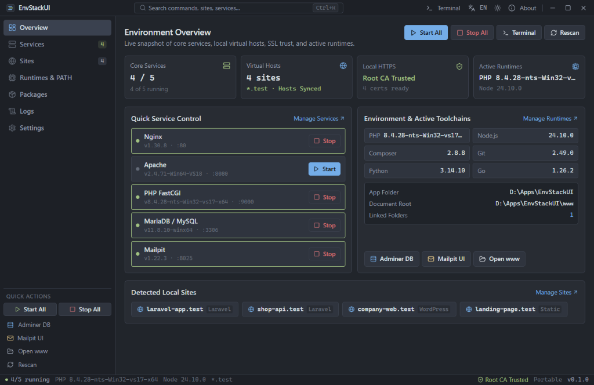
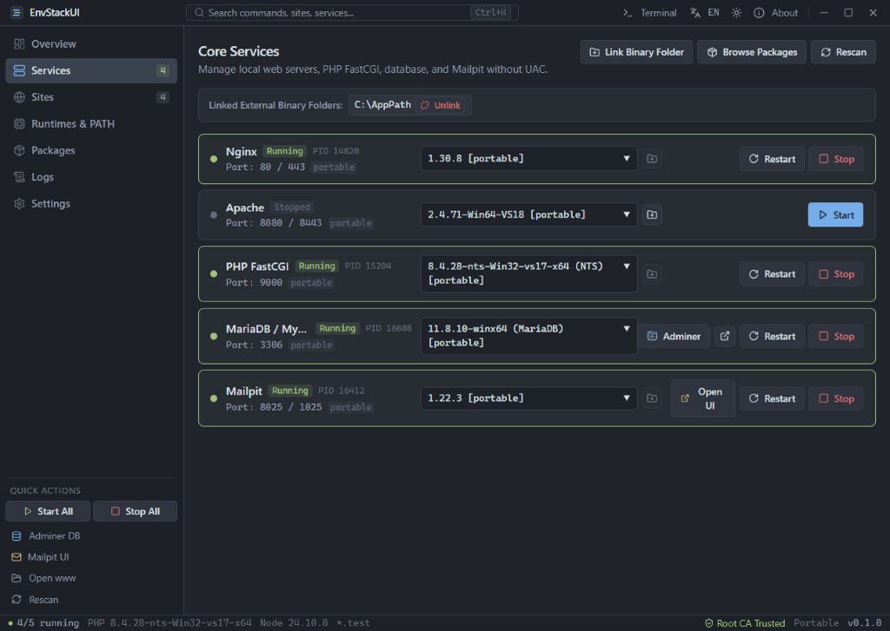
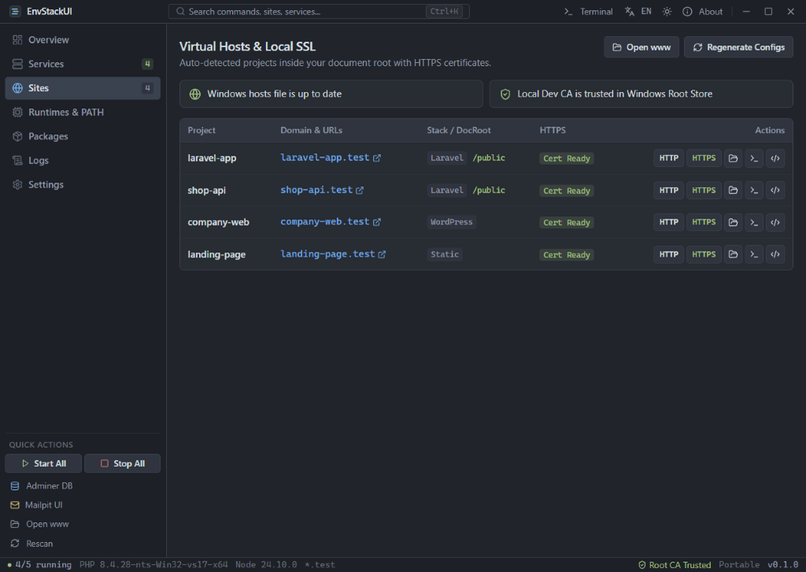
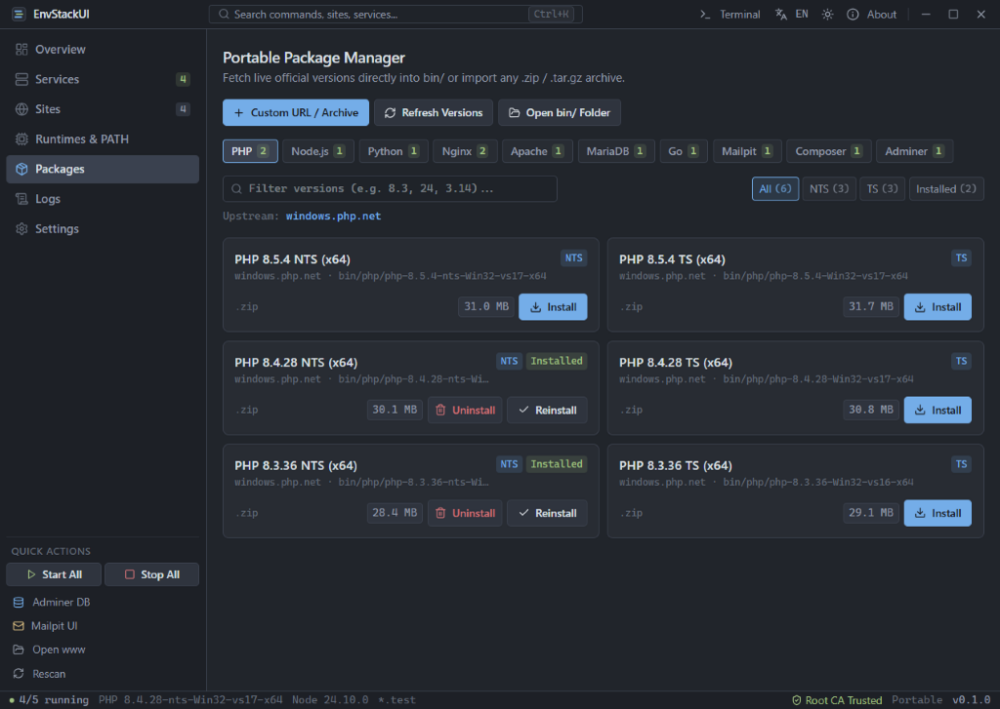
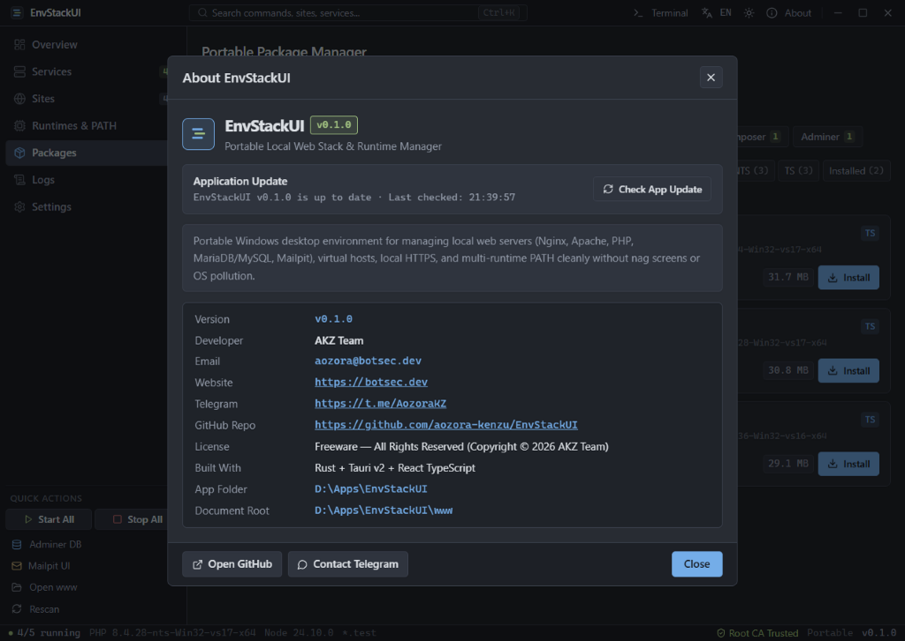

<div align="center">

# EnvStackUI

**Portable Local Web Stack & Multi-Runtime Manager for Windows**

Fast, clean, zero-nag, 100% portable `.exe` — manage **Nginx**, **Apache**, **PHP**, **MariaDB / MySQL**, **Mailpit**, local HTTPS virtual hosts, and multi-runtime toolchains from one sleek desktop workspace.

[](https://github.com/aozora-kenzu/EnvStackUI/releases/latest)
[](https://github.com/aozora-kenzu/EnvStackUI/releases/latest)
[](LICENSE)

[**Download Portable `.exe` (Latest Release)**](https://github.com/aozora-kenzu/EnvStackUI/releases/latest)

</div>

---

## Key Features

- **100% Portable & Zero Nag** — Single standalone `.exe` (~16 MB). No installer, no license popups, no background bloat, no OS pollution.
- **1-Click Self-Update** — Built-in **Update & Restart** replaces the executable in-place with automatic PE & SHA-256 checksum verification and rollback safety.
- **Core Local Services** — Start, stop, restart, restart all, and switch versions for **Apache** (default ports `80 / 443`, `LogFormat` + `mod_php` / Windows FastCGI), **Nginx** (ports `8080 / 8443`), **PHP FastCGI** (auto-respawn supervisor + TS/NTS detection), **MariaDB / MySQL** (auto-initialized `data/` + graceful shutdown), and **Mailpit** (SMTP + Web UI). Includes pre-start config syntax validation (`httpd -t` / `nginx -t`) and port-conflict process diagnostics.
- **One-Click PHP Extensions & Xdebug** — Toggle PHP extensions (`gd`, `intl`, `zip`, `curl`, `xdebug`, etc.) inside `etc/php/php.ini` cleanly without manual editing.
- **Auto Virtual Hosts, Linked Projects & Local HTTPS (`*.test`)** — Watches `www/`, auto-seeds a built-in EnvStackUI landing page (`www/index.php`), lets you link external project folders outside `www/`, auto-detects `/public`, generates Nginx & Apache configs, issues trusted local TLS certificates via **EnvStackUI Local Dev CA**, and supports both Windows `hosts` sync and one-click **Wildcard DNS (`*.test` + subdomains via Windows NRPT)** with non-blocking On-Demand UAC.
- **Live Mailpit Email Popup** — Shows a native bottom-right desktop notification whenever a local email arrives (even when minimized to System Tray); click the popup to open the message directly in **Mailpit Web UI**.
- **Online Package Manager & Custom Importer** — Browse and install official builds of **PHP** (`windows.php.net`), **Node.js**, **Python** (`astral-sh/python-build-standalone`), **Nginx**, **Apache**, **MariaDB**, **Go**, **Mailpit**, **Composer**, and **Adminer** with live download speed, ETA, file sizes, smart filters, and uninstall support — or import any `.zip` / `.tar.gz` archive from a URL or local file.
- **Hybrid Binary Linking** — Reuse existing toolchains on disk (e.g. `C:\AppPath` or other portable folders) without duplicating files, and unlink anytime.
- **Multi-Runtime Portable Terminal & User PATH** — Launch Windows Terminal, PowerShell, Git Bash, or CMD with isolated active toolchains in `PATH`, or optionally sync/clean `HKCU` User `PATH`.
- **Auto-Hosted Adminer + External DB Client** — One-click dark-themed **Adminer** (`/__adminer`) or launch HeidiSQL / DBeaver / TablePlus.
- **Bilingual & Dual Theme** — Instant switching between **English** / **Bahasa Indonesia** and **One Dark** / **One Light**, plus `Ctrl+K` Command Palette, Custom App Context Menu, Single-Instance protection, and built-in GitHub Update Checker.

---

## Screenshots

### Environment Overview


### Core Services


### Virtual Hosts & Local SSL


### Portable Package Manager (Online Versions, Filters & Sizes)


### About & Auto Update Checker


---

## Quick Start

1. Download **`EnvStackUI-v1.0.2-win-x64-portable.exe`** (or **`EnvStackUI-v1.0.2-win-x64-portable.zip`**) from [**GitHub Releases**](https://github.com/aozora-kenzu/EnvStackUI/releases/latest).
2. Place it in any portable folder (for example `D:\Apps\EnvStackUI\EnvStackUI.exe`) and run it — no installation required.
3. On first launch, EnvStackUI automatically creates its portable directory layout alongside the executable:

```text
EnvStackUI/
├── EnvStackUI.exe
├── envstack.json
├── bin/          # Portable binaries (nginx, apache, php, mysql, mailpit, node, python, go, git, composer)
├── etc/          # Auto-generated Nginx, Apache, PHP, MySQL configs & local SSL certificates
├── www/          # Document root for auto virtual hosts (*.test)
├── data/         # Persistent MariaDB / MySQL database files
├── logs/         # Application and service logs
├── tmp/          # Temporary archives, updates, and cached package lists
└── usr/          # Bundled utilities (Adminer)
```

4. Install runtimes from the **Packages** tab (or link an existing folder via **Services → Link Binary Folder**), then click **Start All**.

---

## Requirements

- **OS**: Windows 10 / Windows 11 (64-bit)
- **Runtime**: Microsoft Edge WebView2 Runtime (pre-installed on Windows 10/11)

---

## Contact & Support

- **Developer**: AKZ Team
- **Email**: `aozora@botsec.dev`
- **Website**: https://botsec.dev
- **Telegram**: https://t.me/AozoraKZ
- **Releases & Updates**: https://github.com/aozora-kenzu/EnvStackUI/releases
